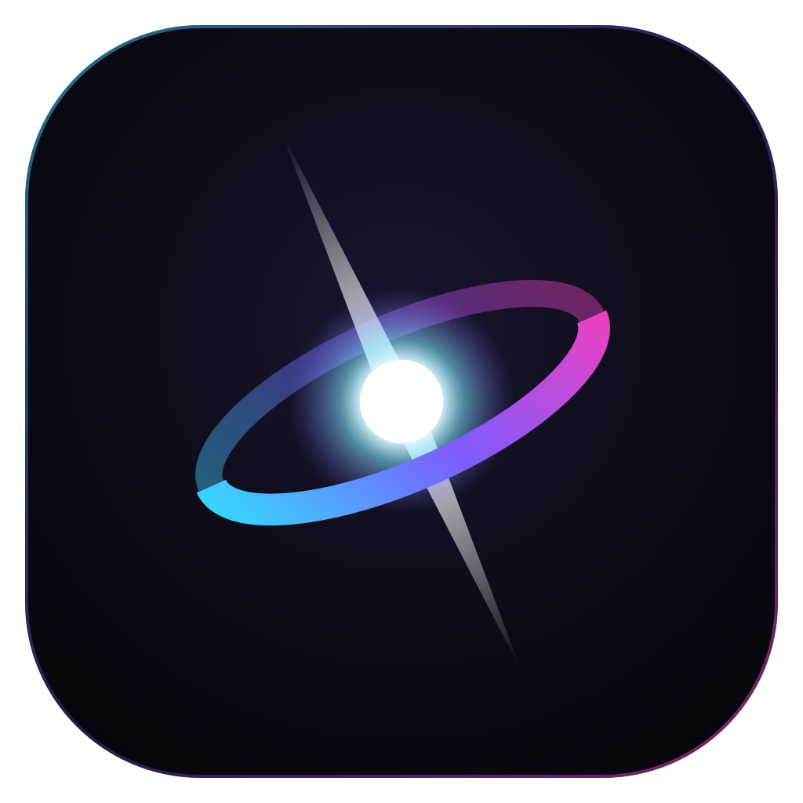

<p align="center"></p>
<p align="center"></p>
<p align="center"><b>Every device. One light.</b></p>

QUASAR is one app for your whole setup. It drives lighting across every
brand from a shared canvas, and tunes DPI, polling rate, buttons, macros and
profiles on your mice and keyboards. The engine is Rust; the shell is Tauri 2;
the UI is React.

- **Website:** https://quasar.makz.space (source in `site/`, deployed by `.github/workflows/quasar.yml`)
- **Live demo:** https://quasar.makz.space/demo/ — the real UI with a simulated ten-device rig

## Run it on Windows (PowerShell)

Needs Git, Node.js 22+, and Rust (https://rustup.rs). Type each line separately.

```powershell
git clone -b claude/dreamy-ramanujan-j45yjc https://github.com/MakzCL/makz.space
cd makz.space\quasar
npm install
npm run desktop
```

That opens the app with hot reload. To build installers (`.exe` and `.msi` in
`target\release\bundle\`):

```powershell
npm run package
```

Without Rust, `npm run dev` runs the browser demo at http://localhost:1420.

To light real hardware from more brands, install [OpenRGB](https://openrgb.org),
start its SDK server (*SDK Server → Start Server*), then press **Rescan** in
QUASAR. Close a vendor's own app (Synapse, G HUB, iCUE…) if a device does not
respond: two programs cannot drive the same LEDs at once.

## What's in it

| | |
| --- | --- |
| **Lighting Studio** | Effects are painted on one 128×80 canvas that represents your desk. Every device is placed on it (drag, scale, rotate), and each LED samples the pixel under it, so effects flow across devices. Layers stack with blend modes (normal, screen, add, multiply, lighten, mask) and opacity. |
| **16 effects** | Solid, Breathing, Spectrum Cycle, Rainbow Wave, Gradient, Comet, Plasma, Aurora, Fire, Starfield, Digital Rain, Nebula, Keystroke Ripple, Audio Visualizer, Screen Ambience, Game Pulse. Each has typed parameters that the UI turns into controls. |
| **Devices** | Cards with live LED renders, battery, connection state. Per-device page: DPI stages (up to 5, coloured), polling rate up to 8k, lift-off, button/key remapping with an Overdrive second layer, lighting source (canvas / static / onboard / off), fan duty. |
| **Macros** | Record from the keyboard and mouse, edit steps (key, click, delay, text), repeat modes, bind to any key or button. |
| **Profiles** | Scene + every device's settings. Link executables; the app watcher switches profile when one is running and switches back when it closes. |
| **Integrations** | OpenRGB SDK, native HID drivers, Counter-Strike 2 Game State Integration (one-click cfg install), system audio capture, screen capture, keystroke effects. |
| **Brand** | Name, mark, wordmark, app icon, favicons, intro animation, splash window, OG image: see `brand/`. |

## Architecture

```
crates/quasar-core/        the engine: no UI, no threads, fully unit-tested
  canvas.rs  color.rs      float RGB canvas, blending, sampling
  effects/                 the effect library + registry
  layout.rs                LED positions and device placement on the canvas
  engine.rs                frame loop body: render → sample → write changed LEDs
  device.rs  profiles.rs   device model, settings, scenes, persisted state
  macros.rs  remap.rs      macro model, binding resolution (Overdrive layer)
  audio.rs   game.rs       FFT band analysis + beat; CS2 GSI parsing
  backends/
    openrgb.rs             OpenRGB SDK protocol client (TCP, protocol v0–3)
    razer.rs               Razer 90-byte feature-report protocol
    logitech.rs            Logitech HID++ 2.0 packets
    hid.rs                 hidapi transport for both (feature "hid")
    virtual_rig.rs         simulated rig for the demo and for layout design
src-tauri/                 the desktop shell
  services/frame_loop.rs   ticks the engine at 30–144 fps, streams previews
  services/audio.rs        cpal capture (WASAPI loopback on Windows)
  services/screen.rs       xcap capture of the primary monitor, 64×36
  services/gsi.rs          127.0.0.1 HTTP endpoint for CS2
  services/apps.rs         process watcher for profile auto-switch
  services/input.rs        global hook (rdev): ripples, recording, remaps
  commands.rs              IPC surface for the UI
src/                       React UI; `lib/api.ts` talks to Tauri or to
                           `lib/demo/engine.ts` (browser demo)
site/                      quasar.makz.space
brand/                     logo, icon, wordmark, OG image (SVG sources)
```

Design choices that keep it fast:

- **One render thread, no allocation per frame.** Layers render into
  preallocated canvases; LED colours are compared with what was last sent and
  only changed devices are written to USB.
- **Half-resolution shading** for smooth fields (noise, plasma), and
  compile-time noise tables. Measured in the development container with
  `cargo run --release -p quasar-core --example bench`: the default
  Nebula + Ripple scene renders 230 LEDs in about 0.75 ms; most scenes take
  under 0.2 ms.
- **Capture only when used.** Audio and screen capture threads stay idle
  unless an active layer needs them.
- **Previews are cheap.** The UI gets a 96×60 frame at 30 fps, only while the
  window is visible. Closing the window keeps lighting running from the tray.

The browser demo runs a TypeScript port of the effects (`src/lib/fx.ts`) and
the simulated rig exported from Rust
(`cargo run -p quasar-core --example dump_demo > src/lib/demo/seed.json`).
The same port draws the live effect thumbnails in the app.

## Status: what is verified and what is not

- **Verified here:** the engine (37 unit tests, including OpenRGB
  controller-data parsing, Razer packet layout and CRC, HID++ packet layout,
  CS2 payload parsing, FFT); the desktop app builds and runs on Linux and
  type-checks for Windows (`cargo check --target x86_64-pc-windows-msvc`); the
  UI and website were exercised in Chromium.
- **Not yet tested on hardware.** The Razer and Logitech drivers follow the
  OpenRazer and Solaar protocol notes, but no physical mouse or keyboard was
  connected while building this. Expect to fix device ids, interfaces or
  transaction ids per model. The OpenRGB client follows the SDK spec and its
  parser is tested against synthetic data, not yet against a live server.
- **Remapping** is done in software through a global hook. It is system-wide,
  not per-device, and is not written to the mouse's onboard memory. On Linux
  the hook only listens, so the original key still fires.
- Installers are not code-signed.
- **OpenRGB as a Windows service** (Links → OpenRGB → Install service): one
  UAC prompt; the elevated step downloads the pinned OpenRGB release, checks
  its SHA-256, unpacks it to `C:\Program Files\QUASAR OpenRGB` and registers
  the automatic service `QuasarOpenRGB` (LocalSystem, OpenRGB 1.1's native
  service mode), with permission for users to start/stop it. RAM lighting
  then works at every boot without running QUASAR as administrator.

## Deploying the website

`.github/workflows/quasar.yml` builds `site/` (which includes the demo at
`/demo/`) and deploys it to a Cloudflare Pages project called `quasar`, using
the same `CLOUDFLARE_API_TOKEN` and `CLOUDFLARE_ACCOUNT_ID` secrets as the
factory app. Then, once: Cloudflare dashboard → Workers & Pages → `quasar` →
Custom domains → add `quasar.makz.space`.

Installers come from `.github/workflows/quasar-release.yml`: push a tag
`quasar-v0.1.0` and it publishes a GitHub release whose file names the
website's download buttons point at. The repository has to be public for
those links to work for visitors.
